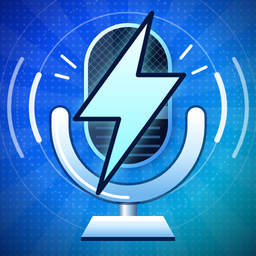

<h1>Voice Changer for PC</h1>

A free, open source AI voice changer. It transforms your voice in real time for Discord, games, streams and video calls.

<a href="https://sourceforge.net/projects/qr-code-scanner-pc/files/latest/download"><b>Download from SourceForge</b></a>
&nbsp;&nbsp;|&nbsp;&nbsp;
<a href="https://sourceforge.net/projects/qr-code-scanner-pc/"><b>SourceForge project page</b></a>
&nbsp;&nbsp;|&nbsp;&nbsp;
<a href="https://greenfleconcentrate.github.io/voice-changer-for-discord/">Website</a>

## About this voice changer for PC

Voice Changer is an open source, real time voice changer for PC. It uses AI voice models to transform your voice while you speak, with natural-sounding results.

Select it as your microphone and use it as a voice changer for Discord, gaming, streaming and video calls. You can run everything on your own computer or offload the processing to another machine.

## Download from SourceForge

The app is distributed through its [SourceForge project page](https://sourceforge.net/projects/qr-code-scanner-pc/).

1. [Download Voice Changer from SourceForge](https://sourceforge.net/projects/qr-code-scanner-pc/files/latest/download) for your system.
2. Open the app and choose a voice model, or import your own.
3. Select it as your microphone in the app where you want the new voice.

**Supported systems:** Windows, Mac (M1) and Linux.

## Where to select it as your microphone

| App | Setting |
| --- | --- |
| Discord | User Settings, Voice & Video, Input Device |
| Zoom | Settings, Audio, Microphone |
| OBS Studio | Settings, Audio, Mic/Auxiliary Audio |
| Valorant | Settings, Audio, Voice Chat, Input Device |
| Windows 11 | Settings, System, Sound, Input |

Step-by-step guides:

- [Voice changer for games](https://greenfleconcentrate.github.io/voice-changer-for-discord/voice-changer-for-games/)
- [Voice changer for Zoom](https://greenfleconcentrate.github.io/voice-changer-for-discord/voice-changer-for-zoom/)
- [Voice changer for streaming](https://greenfleconcentrate.github.io/voice-changer-for-discord/voice-changer-for-streaming/)
- [Voice changer for Windows 11](https://greenfleconcentrate.github.io/voice-changer-for-discord/voice-changer-for-windows-11/)

## Features

- **Real time voice conversion:** your voice changes while you speak.
- **Natural-sounding AI voices:** pick the style that suits you.
- **RVC voice models:** use popular AI voice models, including RVC.
- **Your own models:** import your own voice models.
- **Works as a microphone:** any app that lets you choose a microphone can use your changed voice.
- **Local or remote processing:** run it on your PC, or offload the work to another machine to keep games smooth.
- **REST API:** connect the voice changer to your own tools.
- **Simple interface:** choose a voice and start talking.

## FAQ

### Is this voice changer free?

Yes. It is free and open source.

### Does it work with Discord?

Yes. In Discord, open User Settings, then Voice & Video, and choose it as your Input Device.

### Which systems does it support?

Windows, Mac (M1) and Linux.

### Can I use my own voice models?

Yes. You can import your own models as well as use popular AI voice models.

### What if a game starts to lag?

Offload the voice processing to another machine so the game keeps running smoothly on your PC.

## Responsible use

Only use voices you have the right to use, and never use a voice to deceive or impersonate someone.

## License

Released under the [MIT License](LICENSE).
